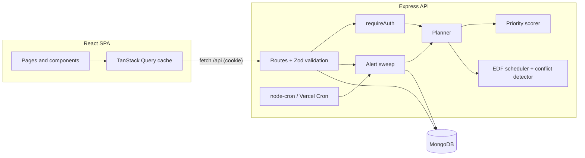

# Cadence: A Calm, Smart Study Planner for Students

Cadence turns a student's assignments, exams and projects into a **ranked to-do list** and a **day-by-day study plan** that fits the hours they actually have. It also **warns before a new deadline breaks the plan**.

**Live app:** _to be added after deployment_

---

## Problem Statement

Students juggle deadlines from five or six courses at once, and each one has a different size, difficulty and stake. A calendar shows *when* things are due but not:

- **what to work on right now**,
- **whether everything can actually get done** with the time they have, or
- **what a newly announced deadline does** to the rest of the week.

So students find conflicts too late, usually the night before two things are due.

## Target Users

University and college students managing several courses, especially those balancing coursework with classes, jobs or commuting, who have limited, uneven study time across the week.

## Solution

The student enters each piece of work with a deadline, a rough effort estimate and a difficulty rating, and tells Cadence how many hours they can study on each weekday. From that, the app:

1. **Scores every task (0–100)** and explains the score. The score combines time pressure (work left ÷ study hours available before the deadline), urgency, difficulty and stakes.
2. **Builds a study plan.** Each day's free hours go to the task with the nearest deadline first (earliest-deadline-first).
3. **Detects conflicts.** It flags tasks that cannot be finished in time even with a perfect schedule, clusters of deadlines on the same day, and overdue work.
4. **Previews impact before saving.** While you type a new deadline it shows the projected priority, when you'd finish, and which existing tasks it would push off track.
5. **Tracks progress and learns.** You log hours and re-estimate what's left, and the plan updates. Insights show on-time rate and how far off your estimates usually are.
6. **Alerts.** A background job creates in-app alerts when work is due within 72h or 24h, is overdue, or has fallen behind.
7. **Board, calendar and focus.** A Kanban board to move work between To do / In progress / Done, a month calendar with `.ics` export, and a focus timer that logs its time to the task.
8. **Checklists.** Break any task into small steps and tick them off.

## Key Features

| Workflow | What the user does | What the system does |
|---|---|---|
| **Account and availability** | Signs up and sets study hours per weekday and a timezone | Hashes the password; stores the timezone so deadlines and days are computed locally |
| **Add a deadline with impact preview** | Fills in title, course, type, deadline, estimate, difficulty | Re-plans with the hypothetical task (debounced) and shows its score, projected finish, shortfall and newly endangered tasks; rejects past deadlines and duplicate entries |
| **Prioritised task list** | Filters by status, course and type, searches, sorts | Ranks by priority score with the reasons shown; filters are kept in the URL |
| **Study plan and conflicts** | Opens the plan | EDF schedule over the coming days, capacity per day, conflicts with suggested fixes |
| **Log progress** | Logs hours, a note, optionally re-estimates or marks done | Updates the task with optimistic concurrency, so stale edits are rejected with 409; the plan and alerts refresh |
| **Insights** | Opens insights | Hours logged per day, on-time rate, estimation accuracy, risk breakdown, workload per course |
| **Alerts** | Opens the bell | Alerts that are never duplicated (due in 72h / 24h, overdue, at risk), with read and unread state |
| **Kanban board** | Drags a card to another column (or uses the arrow buttons on touch screens) | Updates the task's status with the same version check as any edit; the plan refreshes |
| **Calendar** | Browses months, exports deadlines | Month grid coloured by risk; downloads an `.ics` file (with a 1-day reminder) for Google, Outlook or Apple Calendar |
| **Focus timer** | Picks a task and a length (25–90 min), starts, pauses, ends | Timer survives page changes and reloads and shows in the top bar; when it ends the elapsed time is logged as progress |
| **Checklist** | Adds, ticks and removes steps on a task | Atomic array updates, so ticking a step never conflicts with an open edit form; progress shows on rows and cards |
| **Light and dark theme** | Clicks the sun/moon button | Remembered per browser; defaults to the system setting with no flash on load |

New accounts can click **"Try with a sample semester"** to load a realistic workload and explore everything right away.

## Tech Stack

| Layer | Choice | Why |
|---|---|---|
| Frontend | React 18, Vite, React Router, TanStack Query, Tailwind CSS | TanStack Query handles caching, refetching, loading and error states, and cache invalidation after mutations; Tailwind with CSS-variable colour tokens gives one set of classes for both the light and dark theme |
| Backend | Node.js, Express 5 | Express 5 forwards async errors to the error handler natively, so routes have no try/catch boilerplate |
| Database | MongoDB with Mongoose | Task documents with an embedded progress log map naturally; indexes on `(user, status, dueAt)` and unique alert keys |
| Validation | Zod | One schema per request, with field-level error messages returned to the form |
| Auth | JWT in an **httpOnly, SameSite=Lax cookie**, bcrypt (cost 12) | The token can't be read by injected scripts; no token handling in the client |
| Dates | Luxon | Timezone-correct day boundaries (a 9 AM deadline in Kolkata is not a 9 AM UTC deadline) |
| Jobs | node-cron (long-running hosts) / Vercel Cron (serverless) | Same idempotent sweep function behind both |
| Security | helmet, express-rate-limit, CORS allow-list | Rate-limited auth endpoints, secure headers |
| Tests | Node's built-in test runner, Supertest, mongodb-memory-server | API tests run against a real MongoDB in memory; no external services needed |

## Architecture



```
├── api/index.js            Vercel serverless entry (wraps the Express app)
├── client/                 React app
│   └── src/
│       ├── pages/          Dashboard, Tasks, Board, Calendar, Focus, TaskDetail, Plan, Insights, Settings, Auth
│       ├── components/     TaskFormModal (live impact preview), ProgressModal, Checklist, NotificationBell, …
│       ├── lib/            api client, query hooks, formatting, theme, focus session
│       └── context/        auth session
└── server/
    ├── src/
    │   ├── services/       ← the core logic, written as pure functions
    │   │   ├── calendar.js    day buckets and capacity in the user's timezone
    │   │   ├── priority.js    0–100 score + explanations
    │   │   ├── scheduler.js   EDF allocation + conflict detection
    │   │   ├── planner.js     merges score and schedule; what-if impact preview
    │   │   └── alerts.js      idempotent notification sweep
    │   ├── routes/         auth, tasks, schedule, notifications, stats, cron
    │   ├── models/         User, Task, Notification
    │   └── middleware/     auth, validation, error mapping
    └── test/               engine unit tests + API integration tests
```

### How the engine works

**Capacity.** The user's weekly hours become calendar days in their timezone. Today counts only the study hours still ahead (study time is assumed between 08:00 and 23:00). On a deadline day only the hours before the deadline count.

**Priority score**, with up to 100 points:

| Component | Max | Formula |
|---|---|---|
| Time pressure | 45 | `min(remaining ÷ capacityBeforeDeadline, 1.5) ÷ 1.5` |
| Urgency | 30 | `e^(−daysLeft / 7)` |
| Difficulty | 15 | `(difficulty − 1) ÷ 4` |
| Stakes | 10 | exam 1.0 · project 0.8 · assignment 0.6 · quiz 0.5 · other 0.3 |

Overdue tasks score 100. Risk is `critical` when pressure exceeds 1, `at_risk` from 0.7 (or when due within 24h), and `on_track` otherwise.

**Scheduling.** Days are filled in order. Each day's free hours go to the unfinished task with the earliest deadline, with ties broken by score, in 15-minute units. With one shared resource (the student's time), earliest-deadline-first is **optimal for meeting deadlines**: if *any* plan finishes every task on time, EDF does too. So when EDF leaves a task short, that is a real conflict and not a quirk of the algorithm. The task is marked `critical` with its shortfall in hours, even if its own score looked fine.

**Impact preview.** The planner runs twice, once on the current tasks and once with the candidate task added (or the edited version swapped in). It then diffs shortfalls and conflicts.

### Reliability and edge cases handled

- **Ownership:** every query is scoped to `user`, so another user's task id returns 404. That avoids confirming the id exists.
- **Lost updates:** tasks use Mongoose optimistic concurrency, and the client sends the `version` it last saw. A stale edit or progress log returns **409** and the UI refetches.
- **Duplicates:** an open task with the same title (case-insensitive) and deadline is rejected with 409. Alerts are de-duplicated by a unique index on `(user, task, kind, dedupeKey)` plus `$setOnInsert` upserts, so concurrent sweeps can't double-alert. A moved deadline gets a new key and alerts again.
- **Invalid states:** deadlines in the past are rejected on create. You can't log work on a completed task (reopen it first). Zero availability shows a dedicated conflict.
- **Validation:** Zod on every body and query, with errors returned per field and shown next to the input.
- **Failures in the UI:** every page has loading, empty and error states with retry. Network failures show a clear message. An expired session redirects to login.
- **Security:** bcrypt hashes; httpOnly cookie; rate-limited login and registration; the same message for an unknown email or a wrong password; helmet headers; a 100 kB body limit; the cron endpoint is protected by a constant-time secret comparison; no secrets in the repo.

## Local Setup

Requirements: **Node.js 20+** and npm. MongoDB is optional for local development.

```bash
npm install
cp server/.env.example server/.env   # optional: edit values
npm run dev
```

- Web app: http://localhost:5173 (Vite proxies `/api` to the API)
- API: http://localhost:5000

If `MONGODB_URI` is empty, the API starts an **in-memory MongoDB** (data resets on restart). Set `MONGODB_URI` to a local or Atlas database to keep data.

```bash
npm test            # 24 tests: engine unit tests + API integration tests
npm run build       # production build of the client
```

## Environment Variables

Configured in `server/.env` locally, or in the hosting provider's settings. See [server/.env.example](server/.env.example).

| Variable | Required | Description |
|---|---|---|
| `MONGODB_URI` | in production | MongoDB connection string (e.g. MongoDB Atlas) |
| `JWT_SECRET` | in production | Long random string used to sign session tokens |
| `NODE_ENV` | in production | `production` enables secure cookies and requires the two values above |
| `CRON_SECRET` | optional | Enables `GET /api/cron/alerts` for an external scheduler (`Authorization: Bearer <secret>`) |
| `ENABLE_CRON` | optional | `false` disables the in-process 30-minute sweep (default `true`) |
| `SERVE_CLIENT` | optional | `true` makes Express serve `client/dist` (single-server hosting) |
| `CLIENT_ORIGIN` | optional | Allowed CORS origin when the client is hosted on a different domain |
| `VITE_API_URL` | optional (client) | API origin if it differs from the client's origin |
| `MONGOMS_DISABLE_POSTINSTALL` | on CI/hosts | Set to `1` to skip downloading the test MongoDB binary during install |

## Deployment

**Vercel (configured).** [vercel.json](vercel.json) builds the client to `client/dist` and serves the Express app as one serverless function ([api/index.js](api/index.js)) under `/api`. The client and API share an origin, so the auth cookie works without cross-site settings. A Vercel Cron job runs the alert sweep daily. Active users also get a fresh sweep whenever they open alerts (throttled to every 5 minutes). Required settings: `MONGODB_URI`, `JWT_SECRET`, `NODE_ENV=production`, `CRON_SECRET`, `MONGOMS_DISABLE_POSTINSTALL=1`.

**Single server (Render, Railway, a VM).** Build command `npm install && npm run build`, start command `npm start`, with `SERVE_CLIENT=true` and the variables above. The in-process cron then runs every 30 minutes.

**Live URL:** _to be added after deployment_ (sign up, then click "Try with a sample semester" to explore with realistic data)

## API Overview

All routes are under `/api` and, except auth and health, require the session cookie.

| Method | Path | Purpose |
|---|---|---|
| POST | `/auth/register`, `/auth/login`, `/auth/logout` | Session management |
| GET / PATCH | `/auth/me` | Profile, timezone, weekly availability |
| GET | `/tasks?status=&course=&type=&q=&sort=` | Ranked, filtered task list |
| POST | `/tasks` | Create (returns the task and its impact) |
| POST | `/tasks/preview` | What-if impact of a new or edited task |
| POST | `/tasks/sample` | Load a sample semester into an empty account |
| GET / PATCH / DELETE | `/tasks/:id` | Detail with progress log; edit; delete |
| POST | `/tasks/:id/progress` | Log hours, re-estimate, complete |
| POST | `/tasks/:id/checklist` | Add a checklist step |
| PATCH / DELETE | `/tasks/:id/checklist/:itemId` | Tick, rename or remove a step |
| GET | `/schedule` | Day-by-day plan, focus list, conflicts, summary |
| GET | `/stats` | Insights |
| GET | `/notifications`, PATCH `/notifications/:id/read`, POST `/notifications/read-all` | Alerts |
| GET | `/cron/alerts` | Alert sweep for all users (secret-protected) |

## Known Limitations and Next Steps

- The plan is recomputed on each request rather than cached. That is fine at a student's scale (tens of tasks), but a larger deployment would cache it per user and invalidate on writes.
- Alerts are in-app only. Email or push delivery would plug into the same sweep.
- The study window (08:00–23:00) is fixed; per-day time windows and calendar import (ICS/Google) are natural extensions.
